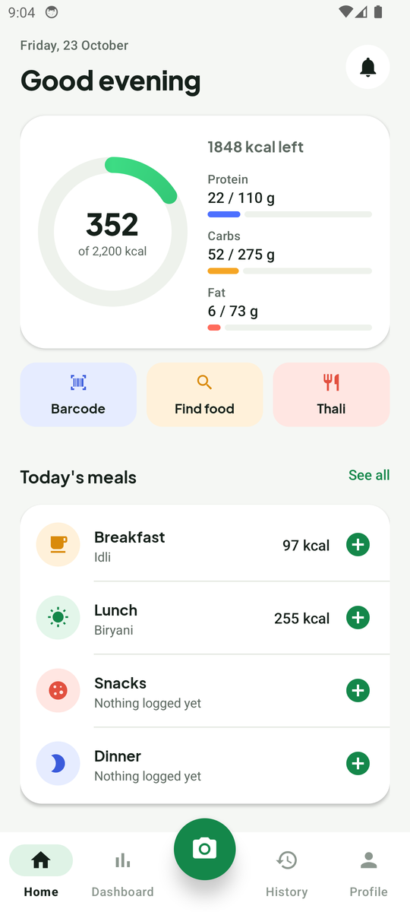
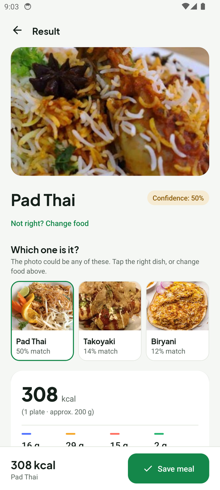
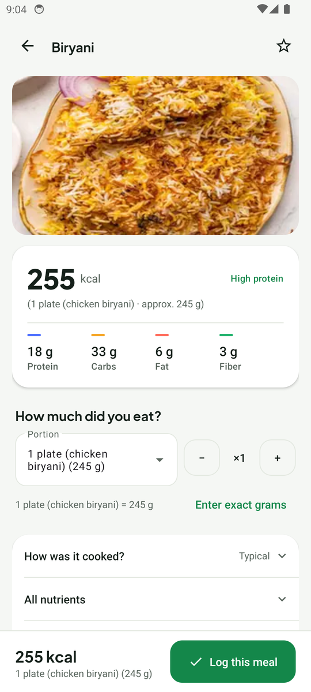
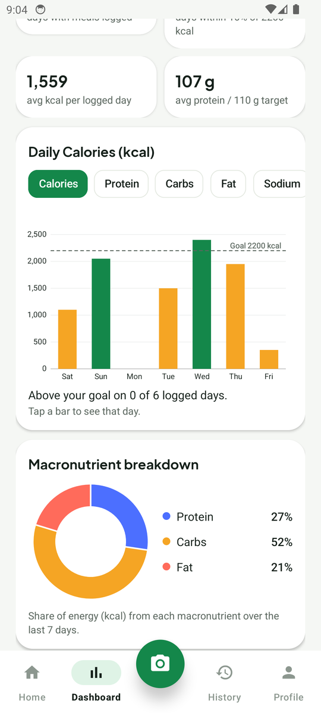
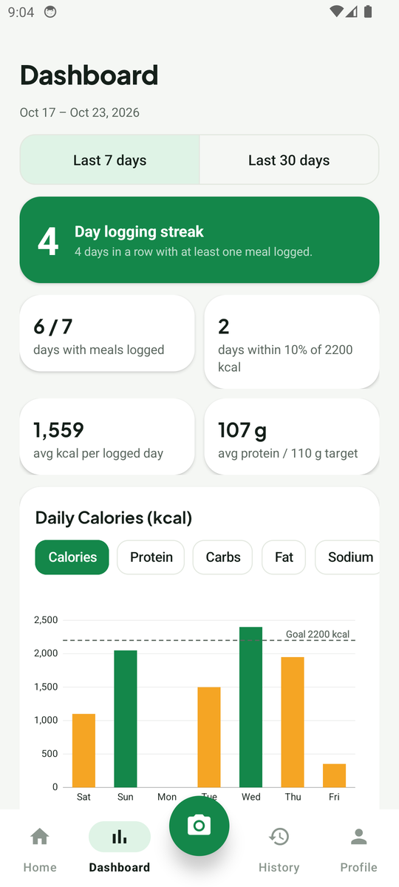
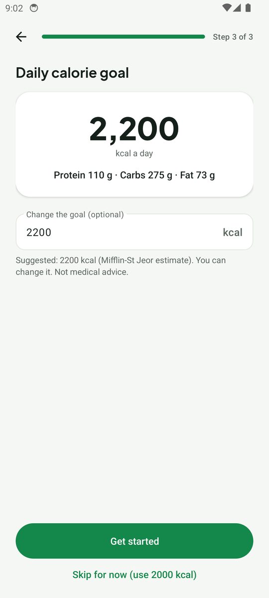
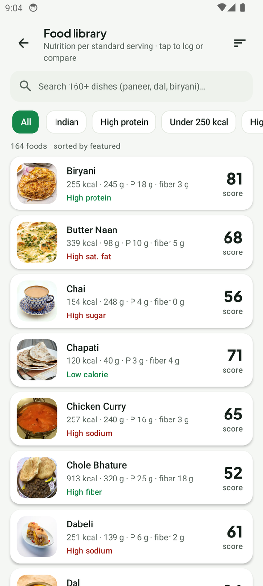
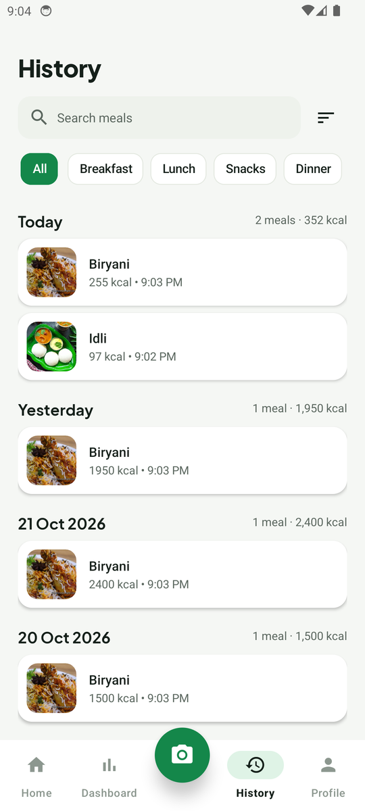
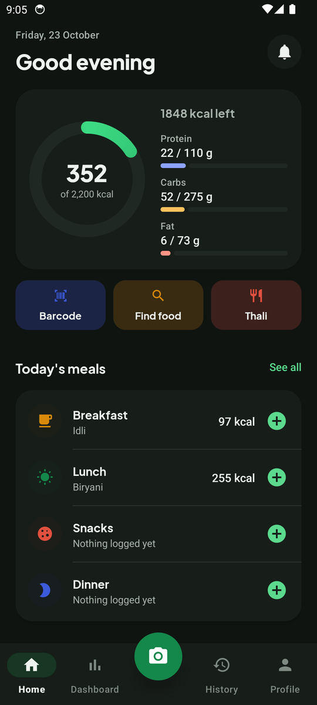
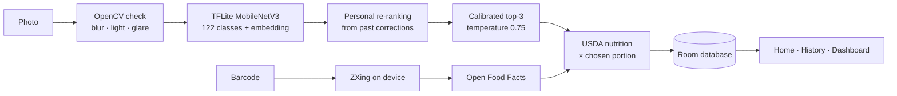

<div align="center">

# NutriLens AI

**Snap a meal, get its nutrition. On-device food recognition and nutrition tracking for Android.**

[](https://github.com/Deep455-16/NutriLens-AI/actions/workflows/android.yml)


</div>

NutriLens AI recognises a dish from a photo **on the phone**, shows its nutrition from the USDA
database, and keeps a daily food log with goals, charts and suggestions. It knows 122 dishes
(Food-101 plus 21 Indian dishes) and 164 foods in total, reads packaged-food barcodes through
Open Food Facts, and works in English and Hindi. Photos never leave the device.

> Nutrition values are typical values for the chosen portion, not a measurement of your plate.
> The app gives no medical or dietary advice.

<p align="center">
  
  
  
  
</p>

## Contents

- [Features](#features)
- [Screenshots](#screenshots)
- [Installation](#installation)
- [How it works](#how-it-works)
- [Model performance](#model-performance)
- [Tech stack](#tech-stack)
- [Project structure](#project-structure)
- [Testing](#testing)
- [Retraining the model](#retraining-the-model)
- [Privacy](#privacy)
- [Limitations](#limitations)
- [Data sources and credits](#data-sources-and-credits)

## Features

### Recognition

- Camera or gallery photo → on-device TensorFlow Lite classifier with a **calibrated confidence**.
- When the model is unsure (top guess under 60%) it asks **"Which one is it?"** with its top three
  guesses as photo cards; any food can also be picked by hand.
- **Live hint** in the camera while framing ("Too dark", "Hold steady", "Looks like Samosa · 92%").
- **OpenCV photo check**: warns about blur, darkness and glare, and brightens dark photos before
  recognition.
- **Several foods on one plate** (a thali): mark each food on the photo; each region is recognised
  separately and saved as one meal.
- **Learns from your corrections**: a corrected dish photographed again is recognised correctly
  (18% → 97% in evaluation) without affecting other dishes.

### Packaged food

- Barcode scanning on the phone (EAN-13, EAN-8, UPC-A, UPC-E) or typed digits, looked up in
  **Open Food Facts** and cached for offline use.

### Nutrition

- USDA FoodData Central values with real portions ("1 plate", "1 katori"), a quantity stepper or
  exact grams, a Nutrition Facts label with % Daily Value, and an explained **Nutrition Score**.
- "How was it cooked?" adjustment (less oil / typical / extra oil or ghee).
- **Build a thali** from common combinations, and **healthier swaps** of the same kind of food.

### Tracking

- Home: calorie ring and macros, **today's meals by breakfast / lunch / snacks / dinner** with a
  "+" for each, quick add, and **what to eat next** for the calories and protein left.
- Saving returns to Home with **"Logged … · Undo"**.
- Dashboard for the last **7 or 30 days**: streak, averages, a daily bar chart against your goal
  (calories, protein, carbs, fat, sodium or sugar), macro split, a 5-week calendar and patterns.
- History grouped by day with search, filters and swipe-to-delete with undo.
- Food library of 164 foods with search (also in Hindi), filters, comparison and favourites.
- Three-step setup that suggests a calorie goal (Mifflin-St Jeor), daily reminder, dark theme.

## Screenshots

| Home | Unsure result | Food detail | Dashboard |
|:---:|:---:|:---:|:---:|
|  |  |  |  |
| **Setup** | **Food library** | **History** | **Dark theme** |
|  |  |  |  |

## Installation

### Requirements

| To | You need |
|---|---|
| Run the app | Android 8.0 (API 26) or newer on an **arm64** device (almost every phone since 2017) |
| Build it | [Android Studio](https://developer.android.com/studio) Koala (2024.1.1) or newer, **JDK 17**, Android SDK 34 |

Internet is needed only for the first Gradle sync and for barcode lookups.

### Option 1 — Install the APK on a phone

1. Get `app-debug.apk`:
   - **From GitHub:** open the [Actions](https://github.com/Deep455-16/NutriLens-AI/actions/workflows/android.yml)
     tab, select the latest successful run, and download the **reports** artifact (it contains
     `app-debug.apk`); or
   - **Build it yourself** (Option 2 or 3 below); the file is written to
     `app/build/outputs/apk/debug/app-debug.apk`.
2. Copy the APK to the phone and open it. When Android asks, allow **Install unknown apps** for the
   app you opened it from (Files, Chrome, …).
3. Or install from a computer with USB debugging enabled:
   ```bash
   adb install -r app-debug.apk
   ```

### Option 2 — Build and run with Android Studio

1. Clone the repository:
   ```bash
   git clone https://github.com/Deep455-16/NutriLens-AI.git
   ```
2. In Android Studio choose **File → Open** and select the `NutriLens-AI` folder.
3. Wait for the Gradle sync to finish (Android Studio downloads Gradle 8.9 and the dependencies).
4. Pick a device or an emulator and press **Run ▶**.

### Option 3 — Build from the command line

```bash
git clone https://github.com/Deep455-16/NutriLens-AI.git
cd NutriLens-AI
echo "sdk.dir=$HOME/Android/Sdk" > local.properties   # path to your Android SDK
export JAVA_HOME=/path/to/jdk-17                      # Gradle needs JDK 17

./gradlew testDebugUnitTest lintDebug assembleDebug   # APK only if tests and lint pass
./gradlew installDebug                                # install on a connected device
```

On Windows use `gradlew.bat` and set `sdk.dir=C\:\\Users\\<you>\\AppData\\Local\\Android\\Sdk`.

### Running on an emulator

- **Apple-silicon Macs** use arm64 emulator images, so the default build runs as is.
- **Intel/AMD PCs** use x86_64 images. Add that ABI when building:
  `./gradlew installDebug -Px86`.
- The emulator camera shows a virtual room, not food. Push a food photo and use
  **Scan → Gallery** instead:
  ```bash
  adb push ml/samples/samosa.jpg /sdcard/Pictures/
  adb shell content call --uri content://media/ --method scan_volume --arg external_primary
  ```
- Barcode test: **Scan → Barcode → Type the number**, e.g. `8901058851298` (needs internet).
- Hindi: `adb shell cmd locale set-app-locales com.nutrilens.ai --locales hi`

## How it works



The app is a single activity with the Navigation Component. Fragments (XML + View Binding) observe
`StateFlow`s from Hilt ViewModels, which use repositories over Room, DataStore, the TFLite
classifier and OpenCV. Business rules (nutrition score, goals, portions, suggestions, insights)
are plain Kotlin and unit-tested.

## Model performance

MobileNetV3-Large fine-tuned on Food-101 and two Indian food datasets, exported as a 6.2 MB
float16 TFLite model. Measured on held-out test photos with exactly the app's preprocessing:

| Test set | Photos | Top-1 | Top-3 |
|---|---:|---:|---:|
| Food-101 validation | 25,250 | **76.7%** | 90.2% |
| Indian food set 1 | 941 | **86.0%** | 94.5% |
| Indian food set 2 | 961 | **91.1%** | 97.4% |

Calibration reduced the expected calibration error from 0.108 to **0.018**. The phone and the Python
evaluation produce identical probabilities to four decimals. Full details, including per-dish
results and the OpenCV and personalisation experiments, are in
[docs/MODEL_CARD.md](docs/MODEL_CARD.md).

## Tech stack

| Area | Libraries |
|---|---|
| Language and UI | Kotlin 2.0, XML layouts, View Binding, Material Design 3, Navigation Component |
| Architecture | MVVM, Hilt (DI), Kotlin Coroutines and Flow |
| Machine learning | TensorFlow Lite (MobileNetV3-Large), OpenCV 4 |
| Camera and barcodes | CameraX, ZXing core |
| Storage | Room (with tested migrations), DataStore |
| Other | Coil (images), MPAndroidChart (charts), WorkManager (reminder) |
| Training (`ml/`) | Python, TensorFlow 2.15, Pillow, PyArrow |
| CI | GitHub Actions: unit tests, lint, APK, emulator tests |

## Project structure

```text
app/src/main/
├── assets/                 food_model.tflite, labels.txt, nutrition.csv, portions.csv,
│                           model_info.json, dish_photos/ (122 WebP photos + SOURCES.csv)
├── java/com/nutrilens/ai/
│   ├── ai/                 FoodClassifier (TFLite, preprocessing, calibration, embedding)
│   ├── vision/             ImageAnalyzer (OpenCV), BarcodeReader (ZXing)
│   ├── data/               Room entities and DAOs, Open Food Facts client, repositories, settings
│   ├── domain/             NutritionScore, goals, portions, suggestions, insights, filters
│   ├── ui/                 home, camera, result, foods, history, dashboard, day, details,
│   │                       onboarding, profile, about
│   ├── util/               formatters, image helpers, time, view extensions
│   └── work/               daily reminder (WorkManager)
└── res/                    layouts, English + Hindi strings, light + dark themes
app/src/test/               JVM unit tests
app/src/androidTest/        Room, migration, OpenCV and Espresso tests
app/schemas/                exported Room schemas
ml/                         training, export, evaluation, calibration and nutrition scripts
docs/                       MODEL_CARD.md, screenshots, font licence
```

## Testing

```bash
./gradlew testDebugUnitTest          # 82 JVM tests: score, goals, portions, filters, suggestions,
                                     # re-ranking, CSV parsing, Open Food Facts parsing, barcodes
./gradlew lintDebug                  # Android lint (0 errors)
./gradlew connectedDebugAndroidTest  # 15 device tests: Room DAO and migrations 1→4, OpenCV check,
                                     # Espresso flows (scan → save → edit → undo → delete)
```

Run the device tests on an emulator with animations turned off. All of these run in CI on every push.

## Retraining the model

```bash
cd ml
pip install -r requirements.txt
# Download the Hugging Face parquet datasets into data/food101, data/indian and data/indian2
python train_model.py --parquet data/food101 --extra data/indian --extra data/indian2 --out export --cpu
cp export/food_model.tflite export/labels.txt ../app/src/main/assets/     # always copy both
python verify_tflite.py --parquet data/food101 --extra data/indian --extra data/indian2 > export/tflite_eval.txt
python calibrate.py --parquet data/food101 --extra data/indian --extra data/indian2 --accuracy export/tflite_eval.txt
```

Each label also needs a nutrition entry (`ml/nutrition_sources.csv`, then `build_nutrition.py`) and a
`food_<label>` string in English and Hindi. The unit tests fail if labels, nutrition and portions
get out of sync.

## Privacy

- Photos, meals and your profile are stored only in the app's private storage; backup is off.
- No account, no analytics, no ads.
- The internet permission is used for one thing: looking up a barcode number in Open Food Facts.
  Only that number is sent.

## Limitations

- **122 recognisable dishes.** Anything else is labelled as the closest known dish; "Change food"
  is always available. 42 further Indian dishes can be logged by hand only.
- **One dish per region.** There is no automatic multi-food detector; mark each food on a thali.
- **Portions are not measured from the photo**; you choose the amount.
- Weakest dishes: biryani vs fried rice, and dal vs other curries.
- Barcode results depend on Open Food Facts (volunteer data; many Indian products are missing).
- Values for the 42 hand-logged Indian dishes are recipe estimates, labelled as such in the app.
- Tested on an Android 14 emulator; not yet on a range of physical phones.
- The Hindi translation still needs review by a native speaker.

## Data sources and credits

| Source | Used for | Licence |
|---|---|---|
| [USDA FoodData Central](https://fdc.nal.usda.gov/) (FNDDS 2021–2023) | nutrition and portions | Public domain |
| [Open Food Facts](https://world.openfoodfacts.org/) | packaged food by barcode | ODbL |
| [Food-101](https://data.vision.ee.ethz.ch/cvl/datasets_extra/food-101/) (ETH Zurich) | training, dish photos | Research use |
| [Indian food images](https://huggingface.co/datasets/rajistics/indian_food_images) | training, dish photos | None stated |
| [Indian foods dataset](https://huggingface.co/datasets/bharat-raghunathan/indian-foods-dataset) | training, dish photos | CC0 |
| [Plus Jakarta Sans](https://fonts.google.com/specimen/Plus+Jakarta+Sans) | titles and numbers | [SIL OFL 1.1](docs/licenses/OFL-PlusJakartaSans.txt) |

The source of each bundled dish photo is listed in `app/src/main/assets/dish_photos/SOURCES.csv`.
One Indian dataset states no licence, which is acceptable for an academic project; check it
before any commercial use.

## License

No open-source licence has been chosen for this project's code yet, so all rights are reserved by
the authors. Third-party data, photos and fonts keep the licences listed above.
