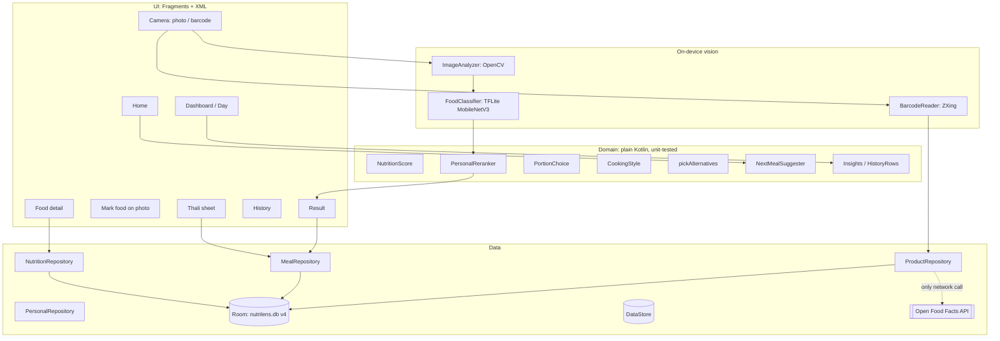

# NutriLens AI — Technical Explanation

> Android app (Kotlin + XML) that recognises food from a photo on the phone, looks packaged food up
> by barcode, and tracks nutrition. Every number in this document was measured on this project's
> code and data; the raw outputs are in `ml/export_v3/`, `ml/export_v2/` and `docs/MODEL_CARD.md`.
>
> Last updated: 23 Oct 2026. (The previous version of this file contained figures and features
> that did not match the app; it is kept in `docs/archive/` for reference only.)

## Contents
1. [What it does](#1-what-it-does)
2. [Architecture](#2-architecture)
3. [How a scan works](#3-how-a-scan-works)
4. [Features](#4-features)
5. [Food data](#5-food-data)
6. [Machine learning](#6-machine-learning)
7. [Storage, privacy and network](#7-storage-privacy-and-network)
8. [Design system](#8-design-system)
9. [Tech stack](#9-tech-stack)
10. [Testing](#10-testing)
11. [Limitations](#11-limitations)

---

## 1. What it does

- **Photo → dish.** A MobileNetV3-Large model on the phone recognises **122 dishes** (the 101 of
  Food-101 plus 21 Indian dishes) with calibrated confidence and its next two guesses.
- **Barcode → packaged food.** Retail barcodes (EAN/UPC) are read on the phone and looked up in
  **Open Food Facts**, an open product database. This is the only feature that uses the internet.
- **Nutrition.** USDA FoodData Central values for each dish and portion, a Nutrition Facts label
  with % Daily Value, and a transparent Nutrition Score.
- **Tracking.** Meal history grouped by day, today's meals by slot, daily targets, a 7/30-day dashboard,
  "what to eat next", favourites and quick add, a daily reminder.
- English and Hindi, light and dark theme.

---

## 2. Architecture

Single activity, Navigation Component, MVVM: Fragments (XML + View Binding) → ViewModels (Hilt) →
repositories → Room / DataStore / TFLite / OpenCV / Open Food Facts.



Source layout: `ai/` (classifier), `vision/` (OpenCV check, barcode reader), `data/` (Room entities
and DAOs, DataStore, Open Food Facts client, repositories), `domain/` (logic), `ui/` (screens),
`util/` (formatting, motion, nutrition label), `work/` (reminder).

---

## 3. How a scan works

### Food photo

```mermaid
sequenceDiagram
    actor User
    participant Camera as CameraFragment
    participant OpenCV as ImageAnalyzer
    participant Model as FoodClassifier
    participant Rerank as PersonalReranker
    participant Result as ResultFragment
    participant DB as Room

    loop about once a second while framing
        Camera->>OpenCV: preview frame
        OpenCV-->>Camera: blurry / dark / glare hint
        Camera->>Model: frame
        Model-->>Camera: "Looks like … 54%"
    end
    User->>Camera: capture (or pick from gallery)
    Camera->>OpenCV: photo quality; brighten if dark
    OpenCV->>Model: 224×224 RGB, Kotlin bilinear resize
    Model-->>Rerank: 122 probabilities + 960-number embedding
    Rerank->>DB: past corrections (embeddings)
    Rerank-->>Result: top guess, calibrated confidence, next guesses
    User->>Result: portion, cooking style, slot, more foods
    Result->>DB: save meal(s) + remember embedding
```

### Barcode

```mermaid
sequenceDiagram
    actor User
    participant Camera as CameraFragment (barcode mode)
    participant ZXing as BarcodeReader
    participant Repo as ProductRepository
    participant DB as Room (packaged_foods)
    participant OFF as Open Food Facts

    Camera->>ZXing: preview frames (1280×720 grey)
    ZXing-->>Camera: EAN-13 / EAN-8 / UPC digits (checked)
    Note over User,Camera: or the user types the digits
    Camera->>Repo: lookup(barcode)
    Repo->>DB: looked up before?
    alt cached on the phone
        DB-->>Repo: product
    else first time
        Repo->>OFF: GET /api/v2/product/{barcode}
        OFF-->>Repo: product JSON or "not found"
        Repo->>DB: cache product
    end
    Repo-->>Camera: Found / NotFound / NoNutrition / Offline / Unavailable
    Camera->>User: food detail (portion, score, log) or a clear message
```

---

## 4. Features

### Recognition
- Top guess with **calibrated confidence** and the next two guesses as one-tap corrections; below
  40% it says "Not sure".
- **Live hint** while framing: photo-quality warnings or "Looks like …".
- **OpenCV photo check:** warns about blur (Laplacian variance < 8), darkness (mean < 60) or glare
  (mean > 225); dark photos are brightened with an auto gamma before recognition. Only steps that
  measurably helped were kept (section 6).
- **Several foods on one plate:** the user draws a box around each food; each is recognised and
  they are saved together as one meal.
- **Learns from corrections:** see section 6.

### Packaged food by barcode
- Reads EAN-13, EAN-8, UPC-A and UPC-E with ZXing on the phone (tries the frame as-is and turned
  90°). Typed numbers are checked with the GS1 check digit.
- Looks the product up in **Open Food Facts** and keeps it on the phone, so it opens offline later.
- Values are per 100 g (100 ml) in Open Food Facts; the app scales them to the pack's stated
  serving, or uses 100 g. Energy falls back from kcal to kJ ÷ 4.184; sodium from salt ÷ 2.5.
  Vitamins and minerals are shown as unknown (–), not 0.
- Clear outcomes: not in the database, in it but without nutrition values, no internet, or the
  service not responding — each with a next step (find a similar food, scan again, use the photo).

### Nutrition
- USDA portions ("1 plate", "1 piece"), a quantity stepper, or exact grams.
- Nutrition Facts label with % Daily Value; DVs scale to the user's calorie goal.
- **Nutrition Score** (0–100), with a tap-to-see breakdown:
  60 + (protein share − 15%) × 100 + min(fiber g per 100 kcal, 2) × 8
  − max(0, fat share − 35%) × 80 − max(0, kcal − 700) / 20, clamped to 0–100.
- **Cooking style** (less oil / typical / extra oil or ghee): a labelled rough estimate that
  changes only fat (×0.65 or ×1.45) and its calories (9 kcal per gram).
- **Build a thali:** four combinations (North Indian, high-protein veg, South Indian, everyday
  home meal) using each dish's dataset serving; untick what you didn't have; saved as one meal.
- **Healthy swaps:** same kind of food (drink / dessert / dish), same cuisine and no more calories
  first, ranked by Nutrition Score.

### Tracking
- Home: today's calories and macros against targets, quick add (favourites and frequent foods),
  "what to eat next" for the remaining calories and protein.
- History grouped by day with each day's meal count and calories; search, slot filter, sort,
  swipe to delete with Undo. Saved meals can be edited (portion, food, slot, time).
- Dashboard for the last 7 or 30 days (averages over logged days against the user's goal,
  streak, days on target, daily bar chart with the goal line, macro split, 5-week calendar,
  most eaten, best/worst meals) and a Day view.
- First-launch setup suggests a calorie goal (Mifflin-St Jeor); daily reminder (WorkManager).

---

## 5. Food data

| | Count | Recognised by the camera | Nutrition source |
|---|---|---|---|
| Food-101 dishes | 101 | yes | USDA FNDDS 2021–2023 |
| Indian dishes in the model | 21 | yes | USDA FNDDS (dhokla: recipe estimate) |
| Extra Indian dishes | 42 | no — search and log by hand | typical-recipe estimates, not lab data |
| Packaged foods | any barcode in Open Food Facts | by barcode | Open Food Facts (ODbL) |

- USDA mapping is chosen by hand in `ml/nutrition_sources.csv`; dishes USDA only lists as
  ingredients are summed from them (e.g. pav bhaji = vegetable curry + butter + 2 pav).
  `ml/build_nutrition.py` produces `assets/nutrition.csv` and `assets/portions.csv`.
- In kadai paneer, paneer is counted as whole-milk mozzarella because the USDA paneer entry looks
  sweetened.
- The 42 extra dishes and dhokla say "Recipe estimate (not lab-measured)" on their detail screen.

Training images: Food-101 (ETH Zurich, 75,750 train / 25,250 test), Indian set 1 (Hugging Face
mirror of a Kaggle set, 5,328 / 941, no licence stated), Indian set 2 (CC0, 3,809 / 961).

---

## 6. Machine learning

**Model.** Keras MobileNetV3-Large (ImageNet weights), global average pooling, dropout 0.25,
dense softmax over 122 classes, plus a second output: the 960-number image embedding. Exported to
float16 TFLite (6.2 MB). Input `[1, 224, 224, 3]` raw RGB 0–255.

**Training** (`ml/train_model.py`, TensorFlow 2.15 on an M4 CPU): 117-class model first (2 head
epochs at Adam 1e-3, then 8 epochs fine-tuning the top 60 layers with BatchNorm frozen at
Adam 1e-4, label smoothing 0.1, batch 64; flip / rotation / zoom augmentation). The 122-class model
continued from it with 1 head + 3 fine-tune epochs, keeping the 117 trained classes.

**Accuracy** (shipped .tflite, run exactly as the app runs it):

| Test set | Photos | Top-1 | Top-3 |
|---|---|---|---|
| Food-101 | 25,250 | 76.7% | 90.2% |
| Indian set 1 | 941 | 86.0% | 94.5% |
| Indian set 2 | 961 | 91.1% | 97.4% |

New dishes: vada pav 92%, kofta 91%, dabeli 89%, dal 75%, biryani 70% top-1 (biryani is most often
confused with fried rice).

**Calibration.** One temperature (T = 0.75) fitted on half of 4,902 held-out photos: expected
calibration error 0.108 → 0.018. Shown confidence 70%+ is right 93% of the time.

**Android ↔ Python parity.** The resize is reimplemented in Kotlin with the training maths;
the phone and Python give the same probabilities to 4 decimals.

**OpenCV, measured** (`ml/vision_eval.py`, 2,441 photos): automatic plate crop 77.3% vs 79.2% for
the whole photo (not used); CLAHE 74.5% vs 79.2% (not used); auto-gamma on darkened photos
71.9% → 74.8% (used, only for dark photos).

**Personalisation, measured** (`ml/personalize_eval.py`): a dish the model got wrong, corrected
once and photographed again: 18.0% → 96.7% correct; dishes never corrected: 76.3% → 77.0%.
Method: k = 5 nearest stored embeddings, cosine ≥ 0.6, blend weight up to 0.6.

---

## 7. Storage, privacy and network

- **Room database** `nutrilens.db`, version 4: `meals`, `nutrition_items` (reloaded from assets),
  `food_portions`, `favorites`, `corrections` (embeddings, max 500), `packaged_foods` (barcode
  cache). Migrations 1→2→3→4 are tested; there is no destructive fallback.
- **DataStore:** profile, goals, settings. **Files:** meal photos in private storage; photos of
  scans that were never saved are deleted on the next start. Backup is off.
- **Network:** the app has the internet permission only for barcode lookups. The single request
  sent is `GET https://world.openfoodfacts.org/api/v2/product/{barcode}.json` with the barcode
  number. Photos, meals, the profile and corrections never leave the phone, and photo recognition
  works offline.

---

## 8. Design system

Defined once in `res/values/themes.xml`, `text_styles.xml` and `colors.xml`: light background,
white cards with soft shadows, one vivid green (#14874A, 4.6:1 contrast with white text),
colour-coded macros, Plus Jakarta Sans (OFL) for titles, numbers and buttons, the system font for
body text, nothing below 12sp, 48dp touch targets, full dark theme and Hindi. Home centres on a
gradient calorie ring (custom `CalorieRingView`) with four tinted action tiles and a raised Scan
button in the bottom bar. All 122 recognised dishes have a real photo (one training example each,
chosen by `ml/export_dish_photos.py` and reviewed by eye; sources in
`assets/dish_photos/SOURCES.csv`). Motion follows Android's "Remove animations" setting.

---

## 9. Tech stack

Kotlin 2.0.20, AGP 8.5.2, KSP, Hilt 2.52, minSdk 26 / target 34. AndroidX: Navigation 2.8.0,
Room 2.6.1, DataStore 1.1.1, WorkManager 2.9.1, CameraX 1.3.4, core-splashscreen.
Material Components 1.12. TensorFlow Lite 2.14, OpenCV 4.10, ZXing core 3.5.3, Coil 2.7,
MPAndroidChart 3.1. Python side: TensorFlow 2.15, pyarrow, Pillow, OpenCV.

---

## 10. Testing

- **82 JVM unit tests** (`app/src/test`): Nutrition Score, goals, portions, cooking style, healthy
  swaps, history grouping, insights, filters (incl. Hindi search), next-meal suggestions,
  re-ranking, cuisine preference in suggestions, CSV parsing, labels ↔ nutrition ↔ portions parity, resize maths, photo-issue
  thresholds, time/DST, barcode decoding (generated EAN-13/EAN-8, upright and sideways, check
  digits), and Open Food Facts parsing using saved real responses (product with serving, drink,
  missing energy, not found, maintenance page).
- **15 device tests** (`app/src/androidTest`): Room DAO, migrations 1→2→3→4, the OpenCV check,
  and Espresso flows (scan → save → edit slot → swipe delete + undo → delete; log from the library).
- Lint: 0 errors. CI: `.github/workflows/android.yml` (runs once the project is on GitHub).

---

## 11. Limitations

- 122 recognisable dishes; anything else is labelled as the nearest one (the top-3 and
  "Change food" are always there). The 42 extra dishes can only be logged by hand.
- No automatic multi-food detection; the user marks foods on the photo.
- Portions are not measured from the photo.
- Barcode lookups need internet and depend on Open Food Facts having the product; its values are
  entered by volunteers and can contain mistakes. Many Indian products are missing.
- Indian dataset 1 states no licence (fine for a college project; check before commercial use).
- Not yet run on a physical phone; speed figures exist only from the emulator.
- The Nutrition Score is an educational heuristic, not medical advice.
